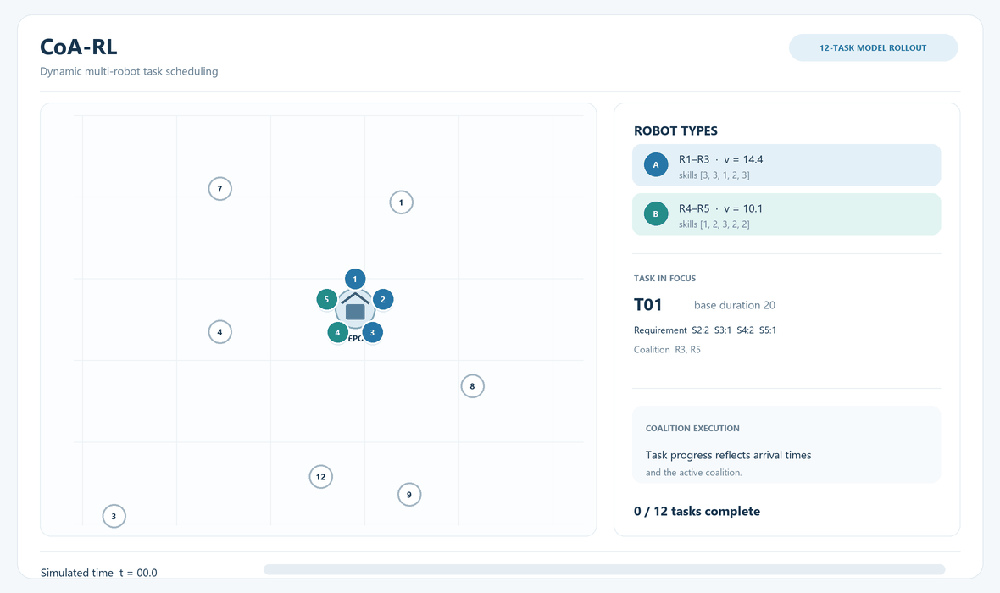

# CoA-RL

Code for the paper **Coalition-aware Reinforcement Learning for Dynamic Multi-robot Task Scheduling**.

Coalition-aware Reinforcement Learning (CoA-RL) constructs schedules for cooperative tasks performed by heterogeneous robot teams. The policy selects a task from the current team state and forms its execution coalition through successive robot decisions. Bidirectional attention represents task and robot information, and schedule simulation provides the state for subsequent decisions.

This repository contains CoA-RL, its three ablation variants, and the RCA-RL, TACO, SAS, and SLPSO comparison methods. Model weights for CoA-RL, the ablations, and RCA-RL are included.



*Illustrative example of robots leaving the depot, forming task coalitions, and returning to the depot.*

## Code structure

- `src/coa_rl_mrta/proposed/coa_rl/`: instance generation, scheduling environment, policy network, ablation variants, inference, and training.
- `src/coa_rl_mrta/baselines/`: RCA-RL, TACO, SAS, and SLPSO.
- `src/coa_rl_mrta/models/`: model weights for the learned methods.
- `examples/instances/`: three G01 instances (30 tasks, 5 robots) from the original S-EC, S-HC, and D-HC test sets.
- `src/coa_rl_mrta/solve.py` and `src/coa_rl_mrta/__main__.py`: Python and command-line interfaces.

## Running instructions

Install the package from the repository root:

```bash
python -m pip install -e .
```

Run a method on one generated instance:

```bash
python -m coa_rl_mrta --method coa-rl --group G01 --type 1 --seed 123
python -m coa_rl_mrta --method coa-rl-nca --group G01 --type 1 --seed 123
python -m coa_rl_mrta --method rca-rl --group G01 --type 1 --seed 123
python -m coa_rl_mrta --method taco --group G01 --type 1 --seed 123 --max-evals 10000
```

Run a supplied test instance with any method:

```bash
python -m coa_rl_mrta --method rca-rl --instance examples/instances/g01_s_ec.npz
```

The three example files are the first instances in the original G01 S-EC, S-HC, and D-HC test groups. They contain instance data only.

The `--method` options are `coa-rl`, `coa-rl-nca`, `coa-rl-nrt`, `coa-rl-ncr`, `rca-rl`, `taco`, `sas`, and `slpso`. Group numbers `1`–`13` directly correspond to the paper labels `G01`–`G13`. Instance types `1`, `2`, and `3` correspond to S-EC, S-HC, and D-HC. For learned methods, `--samples 10` evaluates ten sampled schedules for the same instance and returns the best feasible schedule.

The Python interface accepts an instance in memory:

```python
from coa_rl_mrta.proposed.coa_rl.environment import generate_instance_by_type
from coa_rl_mrta.solve import solve

instance = generate_instance_by_type(1, "1", seed=123)  # G01
result = solve(instance, method="coa-rl", seed=123)
print(result["makespan"])
```

Python 3.7 or newer, PyTorch, NumPy, and SciPy are required. The models can run on a CPU.

## Training

Train CoA-RL from scratch on a small group:

```bash
python -m coa_rl_mrta.proposed.coa_rl.training --groups G01 --instances-per-update 1 --trajectories 2
```

The defaults use four instances and eight sampled trajectories per update. Passing multiple groups trains in small-, medium-, then large-instance order. Only the final model weights are written to `output/`.

The RCA-RL code is adapted from [HeteroMRTA](https://github.com/marmotlab/HeteroMRTA); see its [source and license notes](src/coa_rl_mrta/baselines/rca_rl/SOURCE.md). This repository uses the [Apache-2.0 License](LICENSE).
